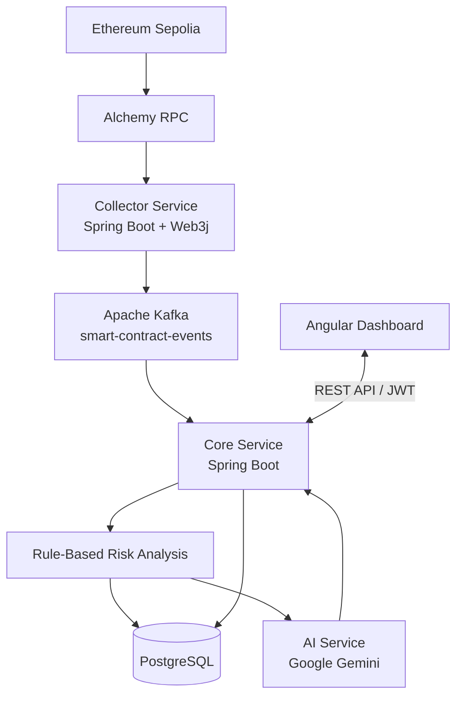
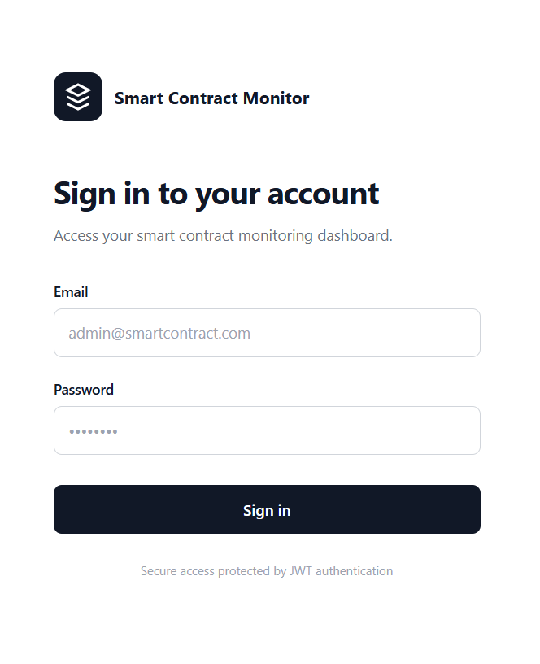
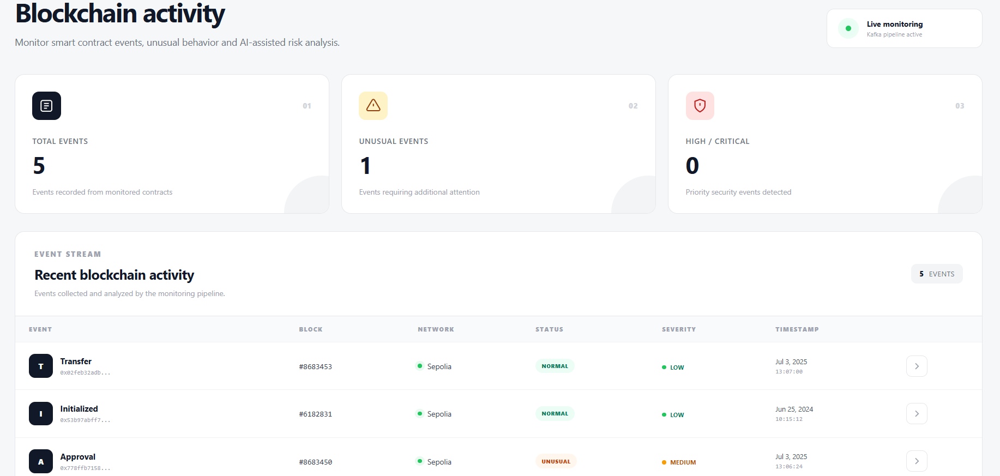
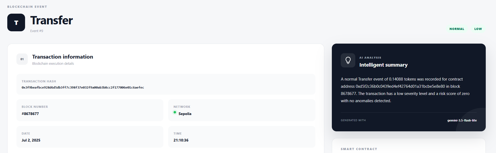
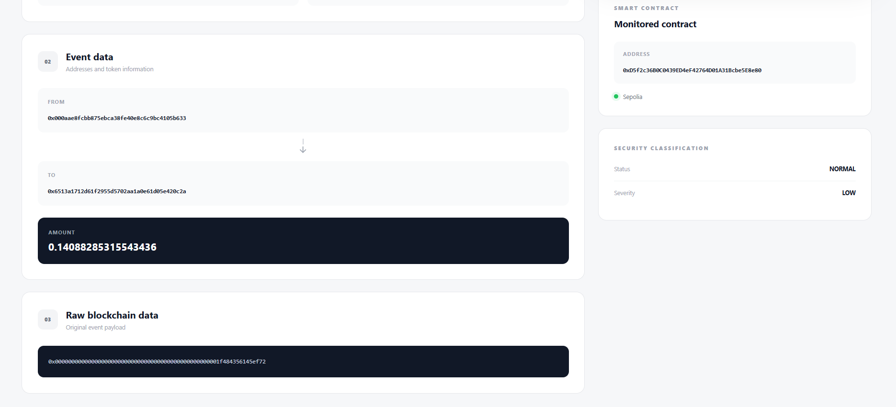

# Smart Contract Monitor

Smart Contract Monitor is a full-stack application designed to collect, analyze, and visualize events emitted by Ethereum smart contracts.

The system retrieves blockchain events from the Ethereum Sepolia test network, processes them through an event-driven architecture using Apache Kafka, and applies rule-based analysis to identify potentially unusual activities.

It also integrates Google Gemini to generate human-readable summaries of analyzed events, helping users understand blockchain activity without manually interpreting raw transaction data.

A web dashboard built with Angular allows users to explore monitored events, review their risk assessments, and access AI-generated summaries.

## Key Features

- **Blockchain Event Collection:** Retrieve and decode smart contract events from Ethereum Sepolia using Web3j and Alchemy.
- **Event-Driven Processing:** Exchange collected events between services through Apache Kafka.
- **Risk Analysis:** Apply predefined rules to classify events and identify potentially unusual activity.
- **AI-Generated Summaries:** Use Google Gemini to explain analyzed events in natural language.
- **Event Dashboard:** Visualize collected events, risk levels, and generated summaries through Angular.
- **Authentication:** Secure user access using Spring Security, JWT, and BCrypt.
- **Data Persistence:** Store smart contract information, events, and summaries in PostgreSQL.


## System Architecture

Smart Contract Monitor uses a service-based, event-driven architecture to separate blockchain data collection, event processing, AI summarization, and user interaction.



### Components

| Component | Responsibility |
|-----------|----------------|
| **Collector Service** | Retrieves and decodes Ethereum smart contract events using Web3j and Alchemy, then publishes them to Kafka. |
| **Apache Kafka** | Transports collected events asynchronously to the Core Service. |
| **Core Service** | Consumes Kafka events, applies risk-analysis rules, manages authentication, and stores results. |
| **AI Service** | Uses Google Gemini to generate natural-language summaries of analyzed events. |
| **PostgreSQL** | Stores users, registered smart contracts, analyzed events, and AI summaries. |
| **Angular Frontend** | Provides authentication and a dashboard for exploring events and their analysis. |

### Event Processing Flow

1. The Collector queries a specified block on Ethereum Sepolia through Alchemy.
2. Web3j retrieves and decodes the smart contract event logs.
3. The Collector publishes the decoded events to an Apache Kafka topic.
4. The Core Service consumes the events and applies predefined risk-analysis rules.
5. The Core Service requests an AI-generated summary from the AI Service.
6. Events, analysis results, and summaries are persisted in PostgreSQL.
7. The Angular dashboard retrieves the stored information through REST APIs.

**Collection behavior:** The Collector currently retrieves historical events from a block number specified in its Java source code when the service starts. It does not continuously subscribe to new blockchain events.


## Technology Stack

| Category | Technologies |
|----------|-------------|
| **Backend** | Java, Spring Boot, Spring Web, Spring Data JPA |
| **Frontend** | Angular, TypeScript, HTML, CSS |
| **Messaging** | Apache Kafka |
| **Blockchain** | Ethereum Sepolia, Web3j, Alchemy RPC |
| **Database** | PostgreSQL, Hibernate |
| **Artificial Intelligence** | Google Gemini API |
| **Security** | Spring Security, JWT, BCrypt |
| **Infrastructure** | Docker, Docker Compose |
| **Build & Development** | Maven, npm, Git |

### Backend Services

The backend is organized into three Spring Boot services:

- **Core Service:** Handles authentication, event processing, risk analysis, persistence, and communication with the AI Service.
- **Collector Service:** Retrieves Ethereum smart contract events, decodes their data, and publishes messages to Kafka.
- **AI Service:** Integrates Google Gemini to generate natural-language summaries of analyzed events.

Each service has its own Maven configuration and can be started independently.


## Project Structure

```text
smart-contract-monitor/
├── services/
│   ├── core-service/                # Event analysis, authentication, persistence
│   ├── collector-service/           # Ethereum event collection and Kafka producer
│   └── ai-service/                  # Gemini AI summary generation
│
├── frontend/
│   └── smart-contract-monitor-ui/   # Angular web application
│
├── docs/                            # Documentation and screenshots
│
├── docker-compose.yml               # PostgreSQL and Kafka infrastructure
├── .env.example                     # Example environment configuration
├── .gitignore                       # Git exclusion rules
└── README.md                        # Project documentation
```

### Repository Organization

- **`services/`** contains the three independent Spring Boot applications, each with its own Maven configuration.
- **`frontend/`** contains the Angular application responsible for the user interface.
- **`docs/`** is reserved for supporting documentation, architecture diagrams, and screenshots.
- **`docker-compose.yml`** provides the PostgreSQL database and Apache Kafka broker required by the application.
- **`.env.example`** documents the environment variables needed to configure the services.


## Getting Started

### Prerequisites

Before running Smart Contract Monitor, make sure the following tools are installed:

- **Java 21** — To run the Spring Boot services.
- **Apache Maven** — To build and run the backend services.
- **Node.js and npm** — To install dependencies and run the Angular frontend.
- **Docker and Docker Compose** — To run PostgreSQL and Apache Kafka.
- **Git** — To clone the repository.

You will also need:

- An **Alchemy API key** with access to the Ethereum Sepolia network.
- A **Google Gemini API key** for AI-generated event summaries.

PostgreSQL and Kafka do not need to be installed separately because they are provided through Docker Compose.


### 1. Clone the Repository

```bash
git clone https://github.com/YOUR_USERNAME/smart-contract-monitor.git
cd smart-contract-monitor
```

Replace `YOUR_USERNAME` with the repository owner's GitHub username.

### 2. Configure Environment Variables

Create a `.env` file in the project root using `.env.example` as a template.

```powershell
Copy-Item .env.example .env
```

Open `.env` and configure the required values:

| Variable | Description |
|----------|-------------|
| `DB_URL` | PostgreSQL JDBC connection URL |
| `DB_USERNAME` | PostgreSQL username |
| `DB_PASSWORD` | PostgreSQL password used by Docker Compose and the Core Service |
| `JWT_SECRET` | Secret used to sign and verify JWT tokens |
| `ADMIN_PASSWORD` | Password for the default administrator account |
| `ALCHEMY_RPC_URL` | Ethereum Sepolia RPC endpoint from Alchemy |
| `GEMINI_API_KEY` | Google Gemini API key |
| `KAFKA_BOOTSTRAP_SERVERS` | Kafka broker address |
| `AI_SERVICE_URL` | Base URL of the AI Service |

Use a strong, randomly generated JWT secret and a unique administrator password.

**Security:** Never commit `.env` or real API keys to Git. The repository includes `.env.example` with placeholder values.


### 3. Start PostgreSQL and Kafka

The project uses Docker Compose to run PostgreSQL and Apache Kafka locally.

From the project root, execute:

```powershell
docker compose up -d
```

Docker Compose starts two containers:

| Container | Service | Port |
|-----------|---------|------|
| `scm-postgres` | PostgreSQL 17 | `5432` |
| `scm-kafka` | Apache Kafka | `9092` |

Check that both containers are running:

```powershell
docker compose ps
```

PostgreSQL should report a healthy status.

The database `observer_db` is created automatically when PostgreSQL initializes its data volume. The Core Service uses Spring Data JPA and Hibernate to create or update the application tables when it starts.

Kafka is configured in KRaft mode and does not require a separate ZooKeeper service.

#### Persistent Storage

Docker Compose uses named volumes to preserve PostgreSQL and Kafka data between container restarts.

To stop the containers without deleting their data:

```powershell
docker compose down
```

**Warning:** Running `docker compose down -v` also removes the project's named volumes, which can permanently delete locally stored database data.


### 4. Load Environment Variables

Spring Boot does not automatically read the `.env` file in the project root.

Before starting a backend service, load the environment variables into its PowerShell terminal.

From the project root, run:

```powershell
Get-Content .env | ForEach-Object {
    $line = $_.Trim()

    if ($line -and -not $line.StartsWith("#")) {
        $parts = $line -split "=", 2

        if ($parts.Count -eq 2) {
            [Environment]::SetEnvironmentVariable(
                $parts[0].Trim(),
                $parts[1],
                "Process"
            )
        }
    }
}
```

This loads the variables from `.env` into the current PowerShell session.

**Important:**

- Run this command in each new terminal used to start a Spring Boot service.
- Environment variables are available only for the current terminal session.
- Keep `.env` private and never commit it to GitHub.
- This loader expects simple `KEY=value` entries, as shown in `.env.example`. Avoid surrounding values with quotes.

Once the variables are loaded, you can start the backend services using Maven.


### 5. Start the Backend Services

The backend consists of three independent Spring Boot applications.

Open a separate PowerShell terminal for each service. In each terminal, navigate to the project root and load the environment variables as described in Step 4.

#### AI Service — Port 8082

Start the AI Service first so it is available when the Core Service requests AI-generated summaries.

```powershell
cd services/ai-service
mvn spring-boot:run
```

The AI Service integrates with Google Gemini to generate natural-language summaries of analyzed blockchain events.

#### Core Service — Port 8080

In a second terminal, start the Core Service:

```powershell
cd services/core-service
mvn spring-boot:run
```

The Core Service:

- Connects to PostgreSQL.
- Subscribes to the `smart-contract-events` Kafka topic.
- Applies rule-based analysis to incoming events.
- Requests summaries from the AI Service.
- Provides REST APIs for the Angular frontend.
- Handles user authentication using Spring Security and JWT.

On startup, the application also creates a default administrator account if one does not already exist. Its password is taken from the `ADMIN_PASSWORD` environment variable.


### 6. Register a Smart Contract

Before collecting blockchain events, the smart contract must be registered in PostgreSQL.

The Core Service uses the `smart_contracts` table to associate incoming events with their corresponding contracts. Events from unregistered contracts cannot be processed successfully.

The following example registers a contract deployed on Ethereum Sepolia.

From the project root, execute:

```powershell
docker exec scm-postgres psql -U postgres -d observer_db -c "INSERT INTO smart_contracts (name, address, blockchain_type, created_at, updated_at) VALUES ('Sepolia Test Contract', '0xd5f2c36b0c0439ed4ef42764d01a31bcbe5e8e80', 'ETHEREUM', CURRENT_TIMESTAMP, CURRENT_TIMESTAMP) ON CONFLICT (address) DO NOTHING;"
```

Verify that the contract has been registered:

```powershell
docker exec scm-postgres psql -U postgres -d observer_db -c "SELECT id, name, address, blockchain_type FROM smart_contracts;"
```

The example contract address is:

```text
0xd5f2c36b0c0439ed4ef42764d01a31bcbe5e8e80
```

You can register another Ethereum smart contract by replacing the name and address with the appropriate values.

**Important:** The registered contract address must match the contract whose events are retrieved by the Collector Service.

The SQL command uses `ON CONFLICT (address) DO NOTHING` so it can be executed again without creating duplicate records.


### 7. Configure Blockchain Event Collection

The Collector Service uses Web3j and Alchemy to retrieve smart contract events from the Ethereum Sepolia test network.

Currently, the Collector performs a historical block query when the application starts. The block range is configured directly in its Java source code.

#### Configure the Block Number

Open `BlockchainService.java` in the Collector Service and locate the `getHistoricalEvents()` method.

Find the block range configuration:

```java
BigInteger fromBlock = BigInteger.valueOf(8683450);
BigInteger toBlock = BigInteger.valueOf(8683450);
```

Both values are set to the same number to query a single Ethereum block.

To test a different block, replace both values with one of the examples below.

#### Example Blocks for Testing

The following Ethereum Sepolia block numbers can be used to explore blockchain event collection:

| Block Number | Event Type |
|-------------|------------|
| `10649113` | To be verified |
| `8683453` | To be verified |
| `8679710` | To be verified |
| `8678679` | To be verified |
| `8678677` | To be verified |
| `8683450` | Approval (verified) |

The `Approval` event from block `8683450` was successfully collected and processed during testing.

The other block numbers are additional examples supplied for testing; their event types and results have not yet been independently verified.

#### Run the Collector

Before starting the Collector, ensure that:

1. PostgreSQL and Kafka are running.
2. The AI Service and Core Service are running.
3. The relevant smart contract is registered in PostgreSQL.
4. `ALCHEMY_RPC_URL` is configured with a valid Ethereum Sepolia endpoint.

Then start the Collector:

```powershell
cd services/collector-service
mvn spring-boot:run
```

The Collector retrieves matching logs, decodes the events, and publishes them to the Kafka topic `smart-contract-events`.

The Core Service consumes these events, performs rule-based risk analysis, stores the results in PostgreSQL, and requests AI-generated summaries.

**Note:** Event collection runs once at Collector startup. To query another block, update the block number and restart the Collector Service.


### 8. Start the Angular Frontend

The Angular application provides a web interface for authentication, exploring blockchain events, reviewing risk assessments, and viewing AI-generated summaries.

Make sure the Core Service is running on port `8080` before starting the frontend.

From the project root, open a new terminal and execute:

```powershell
cd frontend/smart-contract-monitor-ui
npm install
npm start
```

Once the development server starts, open:

**http://localhost:4200**

#### Administrator Login

On the first startup, the Core Service automatically creates an administrator account using `AdminInitializer`, provided that the account does not already exist.

The default administrator email is:

```text
admin@smartcontract.com
```

The password is the value configured in the `ADMIN_PASSWORD` environment variable when the account was first created.

The password is hashed using BCrypt before being stored in PostgreSQL.

**Important:** Changing `ADMIN_PASSWORD` later does not update an existing administrator's password.

#### Using the Dashboard

After logging in, users can:

- Explore blockchain events collected from Ethereum Sepolia.
- Review event classifications, severity levels, and risk scores.
- View AI-generated summaries produced by Google Gemini.

To collect additional events, configure another block number in the Collector Service and restart it.


## Application Screenshots

The following screenshots demonstrate the main features of Smart Contract Monitor.

### Authentication

The login interface provides access to the application through JWT-based authentication.



### Blockchain Activity Dashboard

The dashboard displays monitored blockchain events, including event counts, unusual activity, security classifications, and severity levels.



### Event Details and AI Summary

Users can inspect individual blockchain events, review transaction information, and read natural-language summaries generated by Google Gemini.



### Event Data and Security Analysis

The event details page also provides sender and recipient addresses, token amounts, raw blockchain data, and rule-based security classifications.


